# NeuroFusionAI – Existing Architecture Documentation

**System**: NeuroFusionAI Parkinson's Diagnostic Decision Support System  
**Document**: Existing Architecture & Subsystem Interactions  
**Generated**: 2026-11-02  

---

## 1. System Topology Overview

The existing NeuroFusionAI system follows a service-oriented Python architecture built around **FastAPI**, with a deep learning and machine learning core powered by **PyTorch**, **CatBoost**, and **XGBoost**, backed by a cloud **Neon PostgreSQL** database and a structured local medical object storage subsystem.

```mermaid
graph TB
    subgraph ClientLayer ["Client & Ingestion Tier"]
        Client["Doctor / Patient / API Client"]
        Gateway["FastAPI Gateway (:8000)"]
        Client -->|REST API / Form-Data / JSON| Gateway
    end

    subgraph MiddlewareLayer ["Security & Routing Tier"]
        Gateway --> AuthMiddleware["JWT & RBAC Middleware (Doctor/Patient/Admin)"]
        Gateway --> RequestIdMiddleware["X-Request-ID & Latency Middleware"]
        Gateway --> CorsMiddleware["CORS Configuration Middleware"]
    end

    subgraph RoutingTier ["API Routers (backend/app/api/)"]
        AuthMiddleware --> HealthRouter["/api/health (System Diagnostics)"]
        AuthMiddleware --> ParkinsonRouter["/api/parkinson/* (Standard Endpoints)"]
        AuthMiddleware --> PredictRouter["/predict/* (Prediction Schemas)"]
        AuthMiddleware --> FusionRouter["/predict/fusion (Multimodal Attention)"]
        AuthMiddleware --> ReportsRouter["/api/reports/* (Two-Stage PDF Generation)"]
        AuthMiddleware --> TestingRouter["/api/testing/* (Clinical Benchmarks)"]
        AuthMiddleware --> LegacyAdapters["/analysis/* (Frontend Compatibility)"]
    end

    subgraph ServiceTier ["Core Business Services (backend/app/services/)"]
        ParkinsonRouter & PredictRouter --> VoiceService["voice_service.py"]
        ParkinsonRouter & PredictRouter --> SpiralService["spiral_service.py"]
        ParkinsonRouter & PredictRouter --> TelemonitorService["telemonitor_service.py"]
        ParkinsonRouter & PredictRouter --> MRIService["mri_service.py"]
        FusionRouter --> FusionService["fusion_service.py"]
        ReportsRouter --> PatientReportService["patient_report_service.py"]
        TestingRouter --> EvaluationService["evaluation_service.py"]
    end

    subgraph MLTier ["Machine Learning Core"]
        ModelLoader["ModelLoader (Singleton / Safe Checkpoint Guard)"]
        VoiceService & SpiralService & TelemonitorService & MRIService & FusionService --> ModelLoader
        
        ModelLoader --> Checkpoints["outputs/checkpoints/ (*.pth, *.pkl)"]
        ModelLoader --> VoiceModels["CatBoost + PyTorch MLP (22 Features)"]
        ModelLoader --> SpiralModels["ResNet-18 (256-d Embedding)"]
        ModelLoader --> TelemonitorModels["XGBoost + PyTorch Regressor (19 Features)"]
        ModelLoader --> MRIModels["DenseNet-121 (256-d Embedding)"]
        ModelLoader --> FusionModel["AttentionFusionClassifier (Multi-Head)"]
    end

    subgraph XAITier ["Explainable AI (explainability/)"]
        SpiralService & MRIService --> GradCAMModule["Grad-CAM Engine (Activation Heatmaps)"]
        VoiceService & TelemonitorService --> SHAPModule["SHAP Engine (TreeExplainer Attribution)"]
        FusionService --> AttentionDist["Cross-Modality Attention Weights"]
    end

    subgraph PersistenceTier ["Persistence & Durable Storage"]
        VoiceService & SpiralService & TelemonitorService & MRIService & FusionService --> HistoryService["history_service.py"]
        VoiceService & SpiralService & TelemonitorService & MRIService --> StorageService["storage_service.py"]
        PatientReportService --> HistoryService
        
        HistoryService --> NeonDB[("Neon Cloud PostgreSQL")]
        StorageService --> MedStorage["backend/uploads/medical_storage/ (SHA-256)"]
        PatientReportService --> ReportPDFs["backend/storage/reports/ (*.pdf)"]
    end
```



---

## 2. Subsystem Breakdown

### 2.1 API & Routing Layer
- **Unified Endpoints (`backend/app/api/parkinson.py`)**:
  - Implements uniform clinical diagnostic endpoints:
    - `POST /api/parkinson/voice/predict`: Processes WAV audio / CSV, calculates 22 acoustic features, executes CatBoost & MLP inference, computes TreeExplainer SHAP plots, registers file references, and stores records in Neon DB.
    - `POST /api/parkinson/spiral/predict`: Validates image resolution, runs ResNet-18 inference, computes Grad-CAM heatmaps and overlays, archives drawing to medical storage, and writes database records.
    - `POST /api/parkinson/telemonitoring/predict`: Validates 19 telemon features, predicts Motor UPDRS and Total UPDRS with 95% confidence intervals, computes SHAP values, and persists to Neon DB.
    - `POST /api/parkinson/mri/predict`: Validates brain MRI scan, runs DenseNet-121 inference, computes coronal/axial Grad-CAM heatmaps, and archives scan.
    - `POST /api/parkinson/fusion/predict`: Combines available representations using the Attention Fusion model, evaluates out-of-distribution (OOD) risk, and computes modality attention contributions.
  - History & storage retrieval endpoints:
    - `GET /api/parkinson/history`: Retrieves longitudinal records with filtering and pagination.
    - `GET /api/parkinson/storage/{file_id}`: Serves cryptographically signed medical artifacts.
- **Reporting Endpoints (`backend/app/api/reports.py`)**:
  - Implements the central two-stage clinical reporting workflow:
    - `POST /api/reports/generate/{patient_id}`: Generates Stage 1 (`AI_ANALYSIS`) or Stage 2 (`FINAL_CLINICAL`) ReportLab PDF documents.
    - `GET /api/reports/{report_id}/download`: Streams verified PDF report to authorized doctors and patients.
- **Frontend Compatibility Adapters (`backend/app/main.py`)**:
  - Implements legacy adapter endpoints `/analysis/parkinson/predict` and `/analysis/alzheimer/predict` to ensure existing client contracts remain intact.

### 2.2 Machine Learning & Inference Layer
- **Model Loader (`backend/app/models/loader.py`)**:
  - Singleton pattern loading models onto `cpu` or `cuda`.
  - Implements strict checkpoint validation: if a checkpoint file is missing or fails to load, the model attribute is set to `None`, and `require_model(modality)` raises `RuntimeError` before inference is attempted.
- **Model Registry (`outputs/checkpoints/`)**:
  - Contains genuine trained model checkpoints:
    - `mri_best.pth` (DenseNet-121)
    - `image_best.pth` (ResNet-18)
    - `voice_mlp_best.pth` (PyTorch MLP)
    - `voice_best_model.pkl` (CatBoost)
    - `voice_scaler.pkl` (StandardScaler)
    - `telemonitor_mlp_best.pth` (PyTorch MLP)
    - `telemonitor_best_model.pkl` (XGBoost)
    - `telemonitor_scaler.pkl` (StandardScaler)
    - `fusion_best.pth` (AttentionFusionClassifier)

### 2.3 Explainability Layer (`explainability/`)
- **Grad-CAM Engine (`explainability/gradcam.py`)**:
  - Computes gradient activations on the final convolutional layer of ResNet-18 (`layer4`) and DenseNet-121 (`features.denseblock4`), normalizing heatmaps and superimposing RGB jet colormaps over original patient scans.
- **SHAP Engine (`explainability/shap_analysis.py`)**:
  - Uses `shap.TreeExplainer` on fitted CatBoost and XGBoost models to compute exact Shapley attributions across Oxford vocal biomarkers and telemonitoring clinical features, generating summary and bar plots.
- **Multimodal Attention Distribution (`explainability/fusion_explain.py`)**:
  - Extracts cross-attention weights from the AttentionFusionClassifier to quantify the exact relative contribution of each modality (Spiral, Voice, Telemonitoring, MRI).

### 2.4 Database & Persistence Layer (`backend/app/db/`)
- **Neon Cloud PostgreSQL Engine (`backend/app/db/session.py`)**:
  - Connects to primary serverless cluster `ep-blue-field-b8bw9hgw-pooler.c-14.us-east-1.aws.neon.tech/neondb` via SSL/TLS connection pooling with pre-ping validation.
- **Relational Schema (`backend/app/db/models.py`)**:
  - `doctors`: Clinical practitioners, medical license IDs, hospital affiliations.
  - `patients`: Demographics, age, gender, primary diagnosis, attending physician FK.
  - `model_versions`: Registry tracking version, architecture, and accuracy metrics.
  - `predictions`: Central diagnostic records (modality, confidence, UPDRS scores, clinical notes).
  - `reports`: Clinical report records (`AI_ANALYSIS` vs `FINAL_CLINICAL`, digital approval flags, PDF file paths).
  - `file_references`: Metadata for uploaded raw files and generated XAI plots (SHA-256 hash, signed URL access tokens, expiry).
  - `audit_logs`: HIPAA-compliant audit trail recording every access and modification.

### 2.5 Storage Layer (`backend/app/services/storage_service.py`)
- Manages `backend/uploads/medical_storage/` partitioned into subdirectories: `audio/`, `spiral/`, `mri/`, `telemonitor/`, `gradcam/`, `shap/`.
- Computes cryptographic SHA-256 hashes on write to ensure medical data integrity.
- Generates 32-character secure URL-safe tokens with time-to-live expiration.

---

## 3. Request Lifecycle Walkthrough

```text
1. Client POSTs multipart/form-data to /api/parkinson/voice/predict
   ├── HTTP Request Latency Middleware generates X-Request-ID (e.g., req-8ac0678e9e)
   ├── Security layer extracts Bearer token / role headers and verifies authorization
   └── File validator checks MIME type (audio/wav), size limit (10MB), and magic bytes

2. Service Execution (voice_service.predict_voice)
   ├── Temporarily stages WAV file in backend/uploads/
   ├── Extracts 22 physiological acoustic metrics (Jitter, Shimmer, HNR, RPDE, DFA, PPE)
   ├── Scales features against Oxford benchmark using fitted StandardScaler
   ├── ModelLoader validates PyTorch MLP and CatBoost checkpoints
   └── Computes calibrated ensemble confidence and epistemic uncertainty margin

3. Explainability Generation (shap_service.run_shap_analysis)
   ├── Passes feature vector through TreeExplainer
   ├── Renders SHAP summary plot, feature bar chart, and force plot
   └── Outputs static PNGs into backend/static/

4. Persistence & Archiving
   ├── history_service writes PredictionRecord and AuditLog to Neon PostgreSQL
   ├── storage_service moves raw WAV and SHAP PNGs to backend/uploads/medical_storage/
   └── Computes SHA-256 hash and writes FileReference record to database

5. HTTP Response
   └── Returns prediction_id, prediction class, confidence %, biomarkers, and SHAP links
```

---

## 4. Architectural Strengths and Current Limitations

### Strengths
- **Fully Verified Weights**: All 7 machine learning models use genuine trained checkpoints; no placeholder models.
- **Cloud Database Durability**: Neon Cloud PostgreSQL provides high durability, connection pooling, and relational integrity.
- **Two-Stage Reporting Protocol**: Enforces medical ethics by preventing premature diagnostic report generation without verified test results.
- **HIPAA Data Integrity**: Every stored medical file is checksummed with SHA-256 and accessible only via signed token or doctor authorization.

### Limitations & Areas for Restructuring
- **Dual Preprocessing Locations**: Root `preprocessing/` vs `backend/app/preprocessing/` duplicate logic.
- **Settings Architecture**: Settings should be migrated to a single Pydantic Settings class with environment variable schema validation.
- **Router Directory Organization**: All routers currently reside in `backend/app/api/`; grouping into `v1/` following standard FastAPI conventions will enhance modularity.

