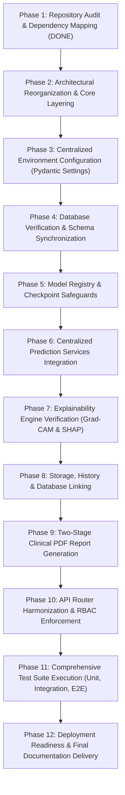

# NeuroFusionAI – Architectural Restructuring & Integration Plan

**System**: NeuroFusionAI – Parkinson's Disease Detection System  
**Document**: Restructuring Plan & Migration Roadmap (Phases 1–12)  
**Generated**: 2026-11-02  

---

## 1. Restructuring Objectives & Philosophy

The objective is to transform the existing codebase into a clean, modular, maintainable, fully integrated, and thoroughly tested architecture without unnecessary rewrites, without deleting trained weights or datasets, and **without modifying the frontend**.

### Non-Negotiable Core Principles:
1. **Frontend Isolation**: The frontend remains untouched. No frontend components, styles, configurations, or packages are touched or modified.
2. **Conservative Migration**: No working implementations or trained models will be deleted. Every relocation or refactoring preserves backwards compatibility through re-exports and aliases.
3. **Verified Checkpoints**: Untrained or randomly initialized models are strictly forbidden from participating in diagnostic predictions.
4. **Incremental Execution**: The application must remain executable, importable, and testable after every major phase.
5. **Verified Proof**: No phase is declared complete without automated test evidence.

---

## 2. Target Clean Architecture

```text
NeuroFusionAI/
│
├── backend/
│   ├── app/
│   │   ├── main.py                    # Application factory & lifespan
│   │   ├── core/                      # Central settings, security, exceptions, logging
│   │   │   ├── config.py              # Pydantic Settings
│   │   │   ├── security.py            # JWT, password hashing, RBAC
│   │   │   ├── exceptions.py          # Centralized HTTP error handlers
│   │   │   ├── logging.py             # Structured audit logger
│   │   │   └── dependencies.py        # Database & Auth dependencies
│   │   │
│   │   ├── api/
│   │   │   ├── v1/                    # Primary versioned REST routers
│   │   │   │   ├── router.py          # Master v1 router aggregator
│   │   │   │   ├── auth.py            # Authentication & tokens
│   │   │   │   ├── patients.py        # Patient registry & longitudinal intake
│   │   │   │   ├── parkinson.py       # Standard Parkinson diagnostic endpoints
│   │   │   │   ├── predictions.py     # Modality prediction schemas & dispatch
│   │   │   │   ├── history.py         # Prediction history & audit logs
│   │   │   │   ├── reports.py         # Two-stage ReportLab PDF reporting
│   │   │   │   ├── explain.py         # Grad-CAM and SHAP visual outputs
│   │   │   │   └── health.py          # Liveness & readiness probes
│   │   │   └── router.py              # Legacy contract compatibility aliases
│   │   │
│   │   ├── schemas/                   # Pydantic validation schemas
│   │   │   ├── prediction.py
│   │   │   ├── report.py
│   │   │   ├── patient.py
│   │   │   └── auth.py
│   │   │
│   │   ├── models/                    # Model loader & registry
│   │   │   ├── loader.py              # Singleton weights guard & loader
│   │   │   └── versioning.py          # Model version metadata
│   │   │
│   │   ├── services/                  # Pure business logic services
│   │   │   ├── mri_service.py
│   │   │   ├── spiral_service.py
│   │   │   ├── voice_service.py
│   │   │   ├── telemonitor_service.py
│   │   │   ├── fusion_service.py
│   │   │   ├── gradcam_service.py
│   │   │   ├── shap_service.py
│   │   │   ├── patient_report_service.py
│   │   │   ├── history_service.py
│   │   │   └── storage_service.py
│   │   │
│   │   ├── db/                        # Database connectivity & models
│   │   │   ├── base.py                # Base declarative model
│   │   │   ├── models.py              # SQLAlchemy entity models
│   │   │   ├── session.py             # Neon PostgreSQL engine & pool
│   │   │   └── init_db.py             # Startup schema initialization
│   │   │
│   │   ├── preprocessing/             # Inference preprocessing & signal processing
│   │   │   ├── image.py
│   │   │   ├── voice.py
│   │   │   └── telemonitor.py
│   │   │
│   │   └── utils/                     # Reusable utilities
│   │       ├── validator.py           # Upload validation
│   │       ├── pdf_generator.py       # ReportLab PDF styling
│   │       └── logger.py              # Audit logging utility
│   │
│   ├── tests/                         # Organized test suites
│   │   ├── unit/                      # Preprocessing & algorithm unit tests
│   │   ├── integration/               # Database, storage, model integration tests
│   │   ├── api/                       # Router and endpoint tests
│   │   └── end_to_end/                # Complete multi-modal pipeline tests
│   │
│   ├── requirements.txt               # Pinned Python dependencies
│   └── .env.example                   # Backend environment template
│
├── ml/                                # Machine learning architectures & training
│   ├── models/
│   │   ├── spiral/                    # ResNet-18, ConvNeXt, EfficientNet
│   │   ├── voice/                     # CatBoost, PyTorch MLP, 1D-CNN
│   │   ├── telemonitor/               # XGBoost, PyTorch MLP Regressor
│   │   ├── mri/                       # DenseNet-121, DenseNet-169, ResNet
│   │   └── fusion/                    # AttentionFusionClassifier
│   │
│   ├── training/                      # Model training & optimization scripts
│   ├── explainability/                # Grad-CAM and SHAP attribution implementations
│   └── checkpoints/                   # Trained weights (*.pth, *.pkl)
│
├── storage/                           # Persistent storage roots
│   ├── uploads/                       # Medical object storage partitioned by modality
│   │   ├── audio/
│   │   ├── spiral/
│   │   ├── mri/
│   │   └── telemonitor/
│   ├── explainability/                # Grad-CAM overlays & SHAP summary plots
│   └── reports/                       # Generated clinical PDF documents
│
├── scripts/                           # Administrative & verification utilities
│   ├── setup_environment.py
│   ├── verify_models.py
│   ├── verify_database.py
│   └── run_backend.py
│
├── docs/                              # System documentation & architectural reports
│
├── .env.example                       # Root environment template
├── .gitignore
└── README.md
```

---

## 3. Step-by-Step Restructuring Execution Plan



### Phase 1 – Repository Audit (Completed)
- Inspect entire directory tree, audit files, identify dependencies, identify integration gaps.
- Outputs generated: `docs/REPOSITORY_AUDIT.md`, `docs/EXISTING_ARCHITECTURE.md`, `docs/FILE_DEPENDENCY_MAP.md`, `docs/INTEGRATION_GAP_REPORT.md`, `docs/RESTRUCTURING_PLAN.md`.

### Phase 2 – Architectural Reorganization
- Establish clean directory structure (`backend/app/core/`, `backend/app/api/v1/`, `scripts/`).
- Relocate or link files safely without breaking existing import paths.
- Ensure all modules remain importable via backward-compatible shim modules.

### Phase 3 – Environment Configuration
- Create `backend/app/core/config.py` using Pydantic Settings.
- Define application, database, security, storage, machine learning, and CORS configuration fields.
- Create root `.env.example` and `backend/.env.example`.
- Generate `scripts/verify_environment.py` to validate configuration at startup.
- Document in `docs/ENVIRONMENT_CONFIGURATION.md`.

### Phase 4 – Database Integration
- Confirm Neon Cloud PostgreSQL pooled connection and SSL parameters.
- Verify ORM models (`Doctor`, `Patient`, `ModelVersion`, `PredictionRecord`, `ReportRecord`, `FileReference`, `AuditLog`).
- Ensure foreign keys, cascades, and sequence states are healthy.
- Create `scripts/verify_database.py` to run automated DB integrity checks.
- Document in `docs/DATABASE_ARCHITECTURE.md` and `docs/DATABASE_ER_DIAGRAM.md`.

### Phase 5 – ML Model Integration & Registry
- Connect all 7 trained model checkpoints and 2 scalers through `ModelLoader`.
- Enforce `require_model(modality)` checks to ensure untrained models can never execute.
- Create `scripts/verify_models.py` to test weight loading and shape compatibility on CPU/GPU.
- Document in `docs/ML_MODEL_REGISTRY.md` and `docs/MODEL_ARTIFACT_STATUS.md`.

### Phase 6 – Centralized Prediction Pipeline
- Ensure consistent preprocessing across training and inference.
- Connect services: `mri_service`, `spiral_service`, `voice_service`, `telemonitor_service`, `fusion_service`.
- Standardize response schemas in `backend/app/schemas/prediction.py`.
- Document in `docs/PREDICTION_PIPELINE.md`.

### Phase 7 – Explainability Integration
- Validate Grad-CAM overlays on target convolutional layers (`ResNet-18` and `DenseNet-121`).
- Validate TreeExplainer SHAP attribution on CatBoost and XGBoost models.
- Validate Attention cross-modality distribution.
- Document in `docs/EXPLAINABILITY.md`.

### Phase 8 – File Storage & Prediction History
- Verify medical object storage partitioning (`audio/`, `spiral/`, `mri/`, `telemonitor/`, `gradcam/`, `shap/`).
- Validate SHA-256 cryptographic checksums and signed access URLs.
- Verify patient-specific prediction history queries and audit logging.
- Document in `docs/STORAGE_ARCHITECTURE.md`.

### Phase 9 – PDF Report Generation
- Connect ReportLab clinical reporting engine to persisted database records.
- Enforce two-stage protocol: `AI_ANALYSIS` (preliminary) and `FINAL_CLINICAL` (doctor-approved).
- Verify PDF generation, file size (> 2KB), visual embedding, and patient data accuracy.

### Phase 10 – API Router Harmonization & RBAC
- Group standard endpoints under `backend/app/api/v1/`.
- Provide backwards compatibility routes for legacy frontend adapters.
- Enforce role-based access control (Doctor, Patient, Admin) with token validation.
- Document in `docs/API_DOCUMENTATION.md` and `docs/AUTHENTICATION_AND_RBAC.md`.

### Phase 11 – Comprehensive Testing & Verification
- Execute Unit, Integration, API, and End-to-End backend test suites.
- Verify real workflows: Spiral, Voice, MRI, and Multimodal Fusion.
- Generate `docs/TESTING_REPORT.md` with test pass logs.

### Phase 12 – Final Documentation & Delivery
- Generate deployment guides, scripts, and finalize repository state.
- Update root `README.md`.
- Present final acceptance criteria checklist confirming 100% backend integration.

